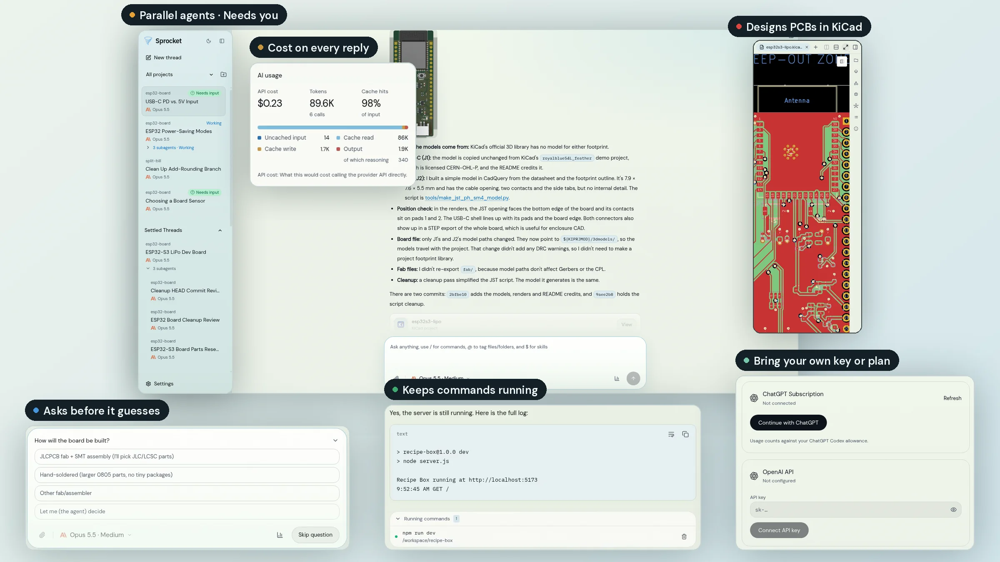

# Sprocket

The best AI agent for hardware and software.

Sprocket designs electronics, tests code end-to-end, and buys parts or subscriptions for your project when asked.

[](https://usesprocket.dev)

## Using Sprocket

Download the desktop app from the [latest release](https://github.com/spikonado/sprocket/releases/latest), or run Sprocket in your browser with [Node.js](https://nodejs.org/) 20.11 or newer:

```sh
npx usesprocket
```

The [docs](https://usesprocket.dev/docs) cover installing, the CLI, configuration, and troubleshooting. They live in [`docs/`](docs) and publish on every push to `main`. For help, contact [aarav@spikonado.com](mailto:aarav@spikonado.com).

## Developing the website

The [usesprocket.dev](https://usesprocket.dev) website lives in `apps/site`. Copy `apps/site/.env.example` to `apps/site/.env`, set `PUBLIC_CONVEX_URL` to the dev deployment's `VITE_CONVEX_URL` from `apps/web/.env.local`, then run `bun dev` in `apps/site`. It serves http://localhost:4321. Variables exported in your shell override `.env`.

## License

Sprocket is licensed under the [Functional Source License, Version 1.1, ALv2 Future License](LICENSE.md). Third-party material remains under the licenses listed in [THIRD_PARTY_NOTICES.md](THIRD_PARTY_NOTICES.md).
