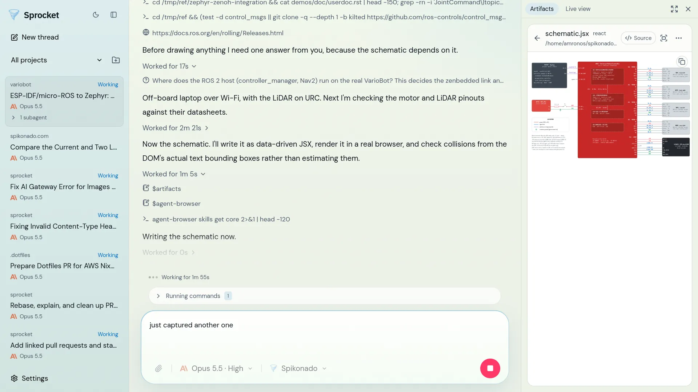

# Sprocket

The best AI agent for hardware and software.

Sprocket designs electronics, tests code end-to-end, and buys parts or subscriptions for your project when asked.

[](https://spikonado.com/sprocket)

## Using Sprocket

### Desktop app

Download the installer for your OS from the [latest release](https://github.com/spikonado/sprocket/releases/latest), install it, and open Sprocket. Sign in, choose a project folder, and ask Sprocket what you'd like to build.

### Run without installing

With [Node.js](https://nodejs.org/) 20.11 or newer installed:

```sh
npx @spikonado/sprocket
```

This opens Sprocket in your browser, or in the desktop app if it's installed. Sign in and choose a project folder to get started. Add `--web` to always use your browser.

### CLI

```sh
npm install -g @spikonado/sprocket
sprocket
```

Open a project folder in the app, or force it to open in your browser:

```sh
sprocket .
sprocket --web ../my-robot
```

To run a task directly from your terminal, run these commands in your project folder:

```sh
sprocket login
sprocket run "Fix the failing tests"
```

Update your CLI installation with `sprocket update`. Run `sprocket --help` for more options.

### Skills

Sprocket loads skills from `.sprocket/skills/<name>/SKILL.md` in your project, then `~/.sprocket/skills/` and `~/.agents/skills/`, then its built-in skills. Type `/name` or `$name` in the composer to use one.

When a skill loads, each `` !`command` `` in its body runs in the thread's working directory, and the command's output (stdout and stderr) replaces it. The agent sees the output, not the command:

```markdown
Current branch: !`git branch --show-current`
```

- The `!` must start a line or follow whitespace, and a single-backtick code span that ends on the same line must follow it. `` KEY=!`cmd` `` stays as text.
- Placeholders inside fenced code blocks don't run. A fence opens at a line whose first non-whitespace characters are three or more backticks or tildes, and closes at a line with at least as many of the same character and nothing else. An unclosed fence runs to the end of the file.
- Placeholders inside another inline code span don't run, including spans that continue across lines of a paragraph. To show the syntax as an example, wrap it in a double-backtick code span, as this README does.
- Commands run one at a time in your default shell (`$SHELL`, or PowerShell on Windows). Each gets 30 seconds, and one skill load gets 60 seconds in total; placeholders left after that are skipped. Output over 20,000 bytes is truncated with a marker.
- A non-zero exit, a timeout, or a shell that fails to start replaces the placeholder with a `[skill command failed: ...]` line.
- Output is inserted as plain text and isn't scanned for more placeholders. Frontmatter isn't scanned.
- Commands run without a prompt for every skill source, including a cloned repository's `.sprocket/skills`. Review skills in repositories you don't trust.

## Troubleshooting

- If `17731` is already occupied, set `SPROCKET_PORT` before launching.
- Sprocket uses your operating system credential service when available, and automatically falls back to an unencrypted private file when it is unavailable. Use `sprocket login --credential-store keyring` to require keyring storage, or `sprocket login --credential-store file` to require file storage.
- If `sprocket` opens the browser instead of the desktop app, install `sprocket-desktop` from [GitHub Releases](https://github.com/spikonado/sprocket/releases) onto `PATH`, or set `SPROCKET_DESKTOP_EXECUTABLE`.
- Unsigned macOS and Windows desktop builds may need a Gatekeeper / SmartScreen override the first time you open them.
- Contact [aarav@spikonado.com](mailto:aarav@spikonado.com) for help.

## License

Sprocket is licensed under the [Functional Source License, Version 1.1, ALv2 Future License](LICENSE.md). Third-party material remains under the licenses listed in [THIRD_PARTY_NOTICES.md](THIRD_PARTY_NOTICES.md).
